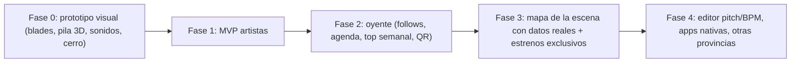

# El Cerro de la Gloria — Plan de proyecto (v2)

> Nombre provisorio. La plataforma gratis de la escena de rap underground de Mendoza.

## 1. Concepto
**Al artista lo atraen las herramientas (tipo Untitled, gratis). Al oyente lo retiene la escena (lo que pasa hoy, esta semana, este mes).**

## 2. Stack ✅

| Capa | Elección |
|---|---|
| Frontend | Next.js (App Router) + TypeScript, PWA |
| 3D / interacción | React Three Fiber + drei, GSAP / Framer Motion |
| Sonidos de UI | Howler.js |
| Backend / DB / Auth | Supabase (Postgres + Auth + RLS) |
| Audio / imágenes | Cloudflare R2 + URLs firmadas |
| Transcodificación | ffmpeg en un worker: del WAV se sacan un MP3 para streaming y la forma de onda |
| Deploy | Vercel |

### ¿Cuándo se empieza a pagar?
**Hacer el deploy no cuesta nada. Solo pagás si te pasás de los límites gratis de cada servicio:**

| Servicio | Gratis hasta | Después |
|---|---|---|
| Cloudflare R2 | **10 GB** guardados por mes + 1M escrituras / 10M lecturas. La transferencia de salida es gratis siempre | ~US\$0,015 por GB extra al mes. Para activarlo te piden una tarjeta, pero no te cobran nada mientras estés debajo del límite |
| Supabase | 500 MB de base de datos, 50k usuarios activos por mes | Plan Pro US\$25/mes. Ojo: en el plan gratis el proyecto **se pausa si pasa 1 semana sin uso** |
| Vercel | Plan Hobby gratis (para proyectos sin fines comerciales) | Pro US\$20/mes, solo si algún día lo monetizás |

Para que tengas una idea: un tema en WAV pesa ~50 MB y en MP3 ~8 MB. Con 10 GB te entran unos 150–200 temas con sus versiones. Para ahorrar espacio, los WAV viejos se pueden comprimir a FLAC.

## 3. Diseño: "Dashboard de consola 2000s + 3D"

### Navegación (blades) ✅
`INICIO` · `COMUNIDAD` · `BIBLIOTECA` · `MAPA` · `@usuario`

- **Inicio:** pila 3D de lanzamientos + lo más escuchado de la semana
- **Comunidad:** feed (snippets, fotos, "hoy grabando") + agenda de shows
- **Biblioteca:** tus proyectos, tracks y versiones (el "Untitled")
- **Mapa:** el cerro 3D con la escena
- **@usuario:** tu perfil MySpace

### Reglas de interacción
- **La rueda del mouse se usa solo para scrollear la página.** Nunca la secuestramos.
- **La pila de tapas 3D se mueve arrastrando con click** (con inercia y snap a cada tapa). Al hacer hover la lámina se adelanta y al hacer click se abre. En el celu funciona igual pero con swipe.
- El cambio de blade se hace con click en la barra, con las flechas del teclado o arrastrando.
- **Ear candy en TODO.** Cada interacción tiene un sonido, aunque sea muy sutil: hover, click, abrir y cerrar, arrastrar (un tick por cada tapa que pasa), cambiar de blade, play/pausa, likes, errores, notificaciones. Volumen bajito y un botón de mute global.
- Fondo vivo: partículas / niebla PS2 que reaccionan al mouse y al audio. Queda preparado para cambiarlo por el GIF o video que me pases.
- Fallback 2D en celulares de gama baja y respeto de `prefers-reduced-motion`.

### El Cerro en 3D ✅
Un cerro low-poly que podés rotar. Los artistas son nodos luminosos y las colaboraciones son líneas entre ellos. Al hacer hover sobre un nodo ves su preview, y al hacer click entrás a su perfil.

### Perfil MySpace ✅
Skin (color, fondo, partículas) + bloques: tema destacado, galería, texto, video, top 8, métricas.

## 4. Modelo de datos (detallado)

**PROFILE**
- `username`, `display_name`, `avatar`, `banner`, `bio`, `ciudad/zona`, `crew`
- `roles`: rapero · productor · beatmaker · ingeniero · visual · oyente
- `links`: IG, Spotify, YouTube, SoundCloud
- `skin`: colores, fondo, partículas, sonido del perfil
- `top8`: lista de perfiles
- **Métricas (se calculan solas):** total de tracks · proyectos · amigos (follow mutuo) · followers · siguiendo · reproducciones totales · colaboraciones
- `invites_left`, `created_at`

**PROJECT**
- `title`, `type` (single · EP · álbum · mixtape · beat tape · WIP), `status` (idea · en proceso · terminado · lanzado)
- `release_date`, `description`, `visibility` (privado · link · público)
- `covers[]` (varias tapas, una marcada como principal)
- Métricas: reproducciones, guardados

**TRACK**
- `title`, `position` en el proyecto, `duration`
- **Metadata:** `bpm`, `key` (ej. *F# menor*), `genre/subgenre`, `mood/tags`, `explicit`, `ISRC` (opcional), `lyrics`, `notas`
- `waveform` (para dibujar la forma de onda)
- Créditos: artista principal, feats, producción, mezcla, master, letra
- Métricas: reproducciones, likes, comentarios

**TRACK_VERSION**: archivo original (WAV/FLAC), MP3 de streaming, número de versión, nota ("mix 3, más bajo el 808"), fecha. Cualquier versión se puede marcar como la actual.

**POST** (feed): tipo (snippet · foto · texto · lanzamiento · "hoy grabando"), media, vínculo a un proyecto o track.

**SHARE_LINK**: token, vencimiento, permitir descarga, contador de veces que se abrió.

**EVENT** (agenda): nombre, lugar, fecha, line-up, flyer, link a entradas.

**FOLLOW**, **LIKE**, **COMMENT**, **INVITE**, **REPORT** (denuncias / bajas).

## 5. MVP (Fase 1)
1. Registro por invitación
2. Perfil con bloques, skin y métricas
3. Proyectos, tracks con metadata y versiones, varias tapas
4. Subida → transcodificación → reproductor persistente
5. Links privados con preview lindo
6. Feed + home de consola con la pila 3D
7. Términos de uso + botón de denuncia

## 6. Roadmap

## 7. Cosas que pueden salir mal (y cómo las evitamos)
- **Que la página se vea muerta.** Si somos 20 artistas y cada uno sube algo una vez por mes, el inicio va a estar vacío y nadie vuelve. → Que subir algo sea muy rápido (un snippet o una foto en 10 segundos), más la agenda de shows, que siempre tiene algo nuevo.
- **Que se filtre un tema inédito.** Si un tema sin sacar aparece por ahí, los artistas dejan de confiar. → Los archivos nunca quedan con un link público directo: cada reproducción usa un link temporal que vence. Además hay backups.
- **Que el 3D ande lento en celulares viejos.** → Si el celu no da, se muestra una versión 2D más liviana.
- **Querer agregar todo y nunca lanzar.** → Lanzamos el MVP con los pibes y después vamos sumando.
